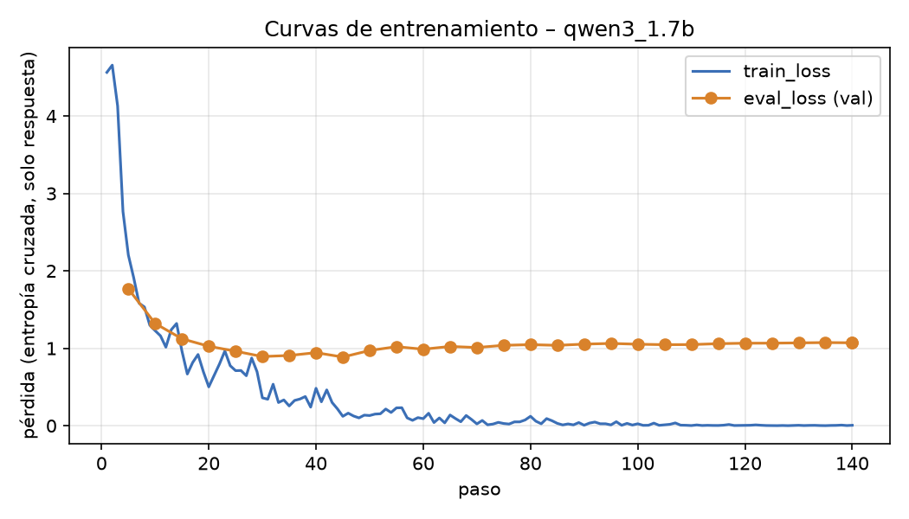
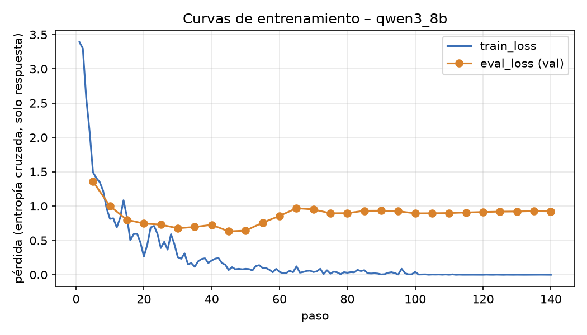
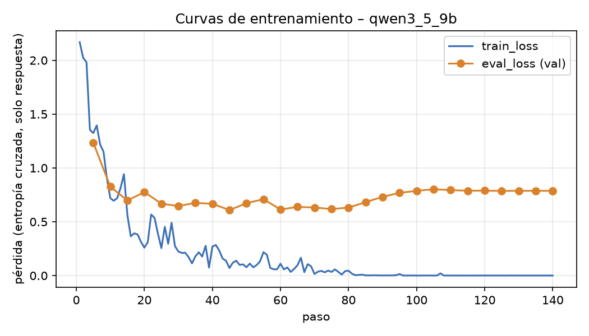
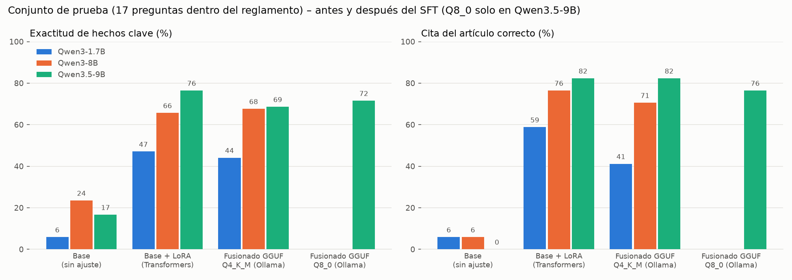

# Informe – Supervised fine-tuning de Qwen3 con QLoRA

**Curso:** Minería Multimedia – Trabajo 4 · **Opción elegida:** A (entrenamiento local con QLoRA) · **Fecha:** noviembre de 2026

> **Declaración de datos.** La temática es un **reglamento ficticio**, el del Laboratorio de Cómputo Acelerado "Nodo Cóndor" (LCA), inventado para este ejercicio. Las 152 preguntas y respuestas son **datos sintéticos**, redactados con asistencia de IA a partir de ese reglamento. No hay datos personales, secretos ni información confidencial.

## 1. Temática y objetivo

Elegimos una normativa inventada porque permite **medir de forma objetiva qué cambió**. El modelo base no puede conocer plazos como "48 horas", códigos como "LCA-07" ni sanciones como "6 meses", así que cualquier acierto del modelo ajustado se puede atribuir al SFT. Cada respuesta de referencia tiene *hechos clave* que se pueden comprobar y termina citando el artículo, por ejemplo "(Art. 7)".

- Reglamento: [`data/reglamento_ficticio.md`](data/reglamento_ficticio.md), con 25 artículos (acceso, reservas, cuotas, almacenamiento, sanciones, etc.).
- Se hicieron tres experimentos con exactamente los mismos datos e hiperparámetros:
  1. **Qwen3-1.7B**, con el flujo completo: base → LoRA → fusión → GGUF → Ollama.
  2. **Qwen3-8B**, para responder si un modelo más grande mejora la exactitud.
  3. **Qwen3.5-9B**, un modelo más reciente con arquitectura híbrida, exportado en **Q4_K_M y Q8_0** para comparar cuantizaciones. Es el modelo de mejor desempeño que cabe en la GPU de 12 GB, tanto para entrenar con QLoRA como para ejecutar en Ollama.

## 2. Entorno y laboratorio

El repositorio del curso (`robertohincapie/Curso_MineriaMultimedia`, rama `master`) solo tiene las unidades 1 a 3 y no incluye `config/laboratorio.yaml` ni código de fine-tuning. Por eso **recreamos el laboratorio** con la misma pila tecnológica:

| Componente | Versión |
|---|---|
| GPU | NVIDIA RTX 4070 SUPER (12 GB), 14 GB de RAM |
| Python / gestor | 3.12 / `uv` |
| Unsloth / unsloth-zoo | 2026.11.2 |
| TRL / Transformers / PyTorch | 1.15.0 / 5.17.0 / 2.14.1 (CUDA 13.0) |
| llama.cpp | commit `67107ac` (conversión a GGUF, `llama-quantize`, `llama-export-lora`) |
| Ollama | 0.40.13 |

## 3. Datos

### 3.1 Formato y conjuntos

Cada línea JSONL tiene esta forma (se muestra una línea real de `data/test.jsonl`):

```json
{"id": "test-004", "question": "Soy estudiante de maestría, ¿cuántas GPUs puedo usar simultáneamente?",
 "answer": "Como estudiante de posgrado puedes usar como máximo 4 GPUs simultáneas. (Art. 8)",
 "articulos": [8], "tipo": "simple", "hechos_clave": ["4 GPUs"], "origen": "sintetico (reglamento ficticio)"}
```

Para entrenar, cada par se convierte al formato de chat de Qwen3: `system` (prompt fijo), `user` (pregunta) y `assistant` (respuesta). El modo de razonamiento queda desactivado (`enable_thinking=False`).

| Conjunto | N | Simples | Combinan 2 artículos | Fuera de alcance | Tokens mín/medio/máx |
|---|---|---|---|---|---|
| [train](data/train.jsonl) | **112** | 88 | 4 | 20 | 102 / 117 / 156 |
| [val](data/val.jsonl) | **20** | 15 | 2 | 3 | 105 / 116 / 144 |
| [test](data/test.jsonl) | **20** | 14 | 3 | 3 | 103 / 121 / 142 |

- **Train** cubre los 25 artículos con 3 o 4 formulaciones cada uno.
- **Val y test** son **paráfrasis nuevas** de hechos vistos en train, preguntas que combinan dos artículos y preguntas **fuera de alcance**. Ante estas últimas, la respuesta correcta es *"El reglamento del LCA no regula ese aspecto…"*.
- **Supuesto declarado:** con SFT no se pueden producir hechos que el modelo nunca vio. Por eso lo que se evalúa es la *generalización a preguntas nuevas* y el *rechazo* de lo que no está en el reglamento, no hechos nuevos.

### 3.2 Validación del dataset

El script [`scripts/validar_dataset.py`](scripts/validar_dataset.py) produce [`resultados/validacion_dataset.md`](resultados/validacion_dataset.md) con **0 errores**. Comprueba:

- el esquema y los tipos de cada campo;
- que cada hecho clave aparezca en su respuesta de referencia;
- que toda respuesta dentro del reglamento cite el artículo;
- que no haya ids ni preguntas duplicadas;
- que no haya casi duplicados entre val/test y train (la similitud máxima es 0,87, por debajo del umbral de 0,90);
- que cada artículo evaluado aparezca en train (25 de 25);
- la longitud en tokens con la plantilla de chat real (máximo 156, frente a `max_seq_length` = 512).

### 3.3 Iteración de datos (v1 → v2)

La primera versión (v1, [`data/v1/train_v1.jsonl`](data/v1/train_v1.jsonl)) tenía exactamente 100 ejemplos de train, de los cuales 8 eran de rechazo. En validación, **ningún** modelo ajustado con v1 rechazó una pregunta fuera de alcance (0 de 3): inventaba una respuesta con el formato recién aprendido. En v2 añadimos 12 ejemplos de rechazo (112 en total; el enunciado fija 100 como mínimo) y el rechazo en validación subió a 1–2 de 3, con una exactitud de hechos similar. **Val y test no cambiaron.**

## 4. Configuración del entrenamiento

Archivos: [`config/laboratorio.yaml`](config/laboratorio.yaml) (1.7B), [`config/laboratorio_8b.yaml`](config/laboratorio_8b.yaml) (8B) y [`config/laboratorio_qwen35_9b.yaml`](config/laboratorio_qwen35_9b.yaml) (Qwen3.5-9B).

| Parámetro | Valor | Comentario |
|---|---|---|
| Modelo | `unsloth/Qwen3-1.7B-unsloth-bnb-4bit` / `unsloth/Qwen3-8B-unsloth-bnb-4bit` / `unsloth/Qwen3.5-9B` (bf16, cuantizado a NF4 al cargarlo) | Base en 4 bits (NF4), **congelada** |
| `max_seq_length` | 512 | El ejemplo más largo tiene 156 tokens |
| LoRA `r` / `lora_alpha` / dropout | **32 / 64** / 0 | Escala α/r = 2 |
| Módulos objetivo | q, k, v, o, gate, up, down. En Qwen3.5 se agregan in_proj_qkv, in_proj_z y out_proj | Todas las capas lineales del modelo de lenguaje. En Qwen3.5, 24 de 32 capas usan atención lineal (Gated DeltaNet), sin q/k/v/o; el codificador de visión queda fuera |
| Parámetros entrenables | 34,9 M (1.7B) · 87,3 M (8B) · 80,2 M (Qwen3.5-9B) | Según Unsloth, 3,3 %, 1,7 % y 1,3 % del total, que cuenta los pesos de 4 bits empaquetados |
| Tasa de aprendizaje | 2e-4, cosine, warmup 5 %, weight decay 0,01 | Optimizador `adamw_8bit` |
| Batch / acumulación | 4×2 (1.7B) · 2×4 (8B y Qwen3.5-9B) | **Batch efectivo de 8** en todos los casos |
| Épocas | **10** (140 pasos) | |
| Pérdida | Solo sobre los tokens de la respuesta | `train_on_responses_only` |
| Semilla | 3407 | |
| Inferencia | `temperature=0` (greedy), `max_new_tokens=160`, mismo prompt de sistema | Comparación determinista |

### 4.1 Cómo se eligieron los hiperparámetros (barrido solo en validación)

Para no filtrar información del conjunto de prueba, el barrido ([`scripts/barrido.py`](scripts/barrido.py)) se evaluó **solo sobre validación**, con el modelo 1.7B. Los resultados están en [`barrido_val_datos_v1.csv`](resultados/qwen3_1.7b/barrido_val_datos_v1.csv) y [`barrido_val.csv`](resultados/qwen3_1.7b/barrido_val.csv).

| Datos | Épocas | lr | r/α | eval_loss mín. | eval_loss final | Hechos val (%) | Cita val (%) | Rechazo fuera de alcance |
|---|---|---|---|---|---|---|---|---|
| v1 | 5 | 2e-4 | 16/32 | 0,908 | 0,929 | 41,2 | 17,6 | 0/3 |
| v1 | 10 | 2e-4 | 16/32 | 0,886 | 1,180 | 58,8 | 64,7 | 0/3 |
| v1 | 15 | 2e-4 | 16/32 | 0,893 | 1,222 | 58,8 | 76,5 | 0/3 |
| v1 | 20 | 2e-4 | 16/32 | 0,896 | 1,319 | 58,8 | 82,4 | 0/3 |
| v1 | 10 | 4e-4 | 16/32 | 0,910 | 1,092 | 55,9 | 70,6 | 0/3 |
| v1 | 10 | 2e-4 | 8/16 | 0,934 | 1,321 | 44,1 | 29,4 | 0/3 |
| v1 | 10 | 2e-4 | 32/64 | 0,884 | 1,212 | 61,8 | 70,6 | 0/3 |
| **v2** | **10** | **2e-4** | **32/64** | 0,878 | 1,130 | **60,8** | 70,6 | 1/3 |
| v2 | 10 | 2e-4 | 16/32 | 0,880 | 1,226 | 52,9 | 64,7 | 2/3 |

**Hallazgo:** `eval_loss` alcanza su mínimo hacia la época 3 y luego **sube**, pero la exactitud de hechos en validación **sigue mejorando hasta la época 10**. El sobreajuste medido por la pérdida (el modelo se vuelve muy seguro de la redacción exacta del train) no coincide con la utilidad: para memorizar datos concretos hace falta "sobreentrenar" en términos de pérdida. Por eso elegimos los hiperparámetros con una métrica de tarea y no solo con `eval_loss`. Los mismos hiperparámetros se aplicaron al 8B y al Qwen3.5-9B, sin un barrido propio, para que la comparación entre modelos sea justa.

## 5. Evidencia del entrenamiento

| | Qwen3-1.7B | Qwen3-8B | Qwen3.5-9B |
|---|---|---|---|
| Pasos / épocas | 140 / 10 | 140 / 10 | 140 / 10 |
| train_loss: inicial → final | 4,56 → 0,006 | 3,39 → 0,0006 | 2,17 → 0,0006 |
| eval_loss mínima (paso, época) | 0,887 (45, 3,2) | 0,632 (45, 3,2) | 0,609 (45, 3,2) |
| eval_loss final / perplejidad en val | 1,071 / 2,92 | 0,923 / 2,52 | 0,787 / 2,20 |
| Duración del entrenamiento | 39 s | 197 s | 290 s |
| VRAM pico durante el entrenamiento* | 1,84 GB | 8,17 GB | 7,23 GB |
| Tamaño del adaptador LoRA | 144 MB | 344 MB | 326 MB |

\* `torch.cuda.max_memory_reserved()` después de reiniciar el contador al empezar a entrenar. En Qwen3.5-9B, los pesos cargados ya ocupaban 7,97 GB antes del entrenamiento, así que su pico real en la GPU es mayor que la cifra de la tabla; los 12 GB alcanzaron.

Registro completo por paso: [`log_entrenamiento.csv` del 1.7B](resultados/qwen3_1.7b/log_entrenamiento.csv), [del 8B](resultados/qwen3_8b/log_entrenamiento.csv) y [del Qwen3.5-9B](resultados/qwen3_5_9b/log_entrenamiento.csv). Resúmenes: [`resumen_entrenamiento.json` del 1.7B](resultados/qwen3_1.7b/resumen_entrenamiento.json) y [del 8B](resultados/qwen3_8b/resumen_entrenamiento.json).





## 6. Exportación a GGUF y Ollama

**QLoRA en la práctica:** durante el entrenamiento, los pesos base W quedan congelados en 4 bits y solo se entrenan A (r×k) y B (d×r). La fusión calcula W' = W + (α/r)·B·A y produce un modelo autónomo que ya no necesita el adaptador.

| | 1.7B | 8B | Qwen3.5-9B |
|---|---|---|---|
| Fusión | Unsloth `save_pretrained_merged` (16 bits, en PyTorch) | **`llama-export-lora`** (en GGUF, tensor a tensor) | **`llama-export-lora`** |
| Pasos | merged → `convert_hf_to_gguf` f16 (3,3 GB) → `llama-quantize` **Q4_K_M (1,06 GB)** | adaptador → GGUF (167 MB); base `Qwen/Qwen3-8B` → GGUF f16; fusión f16 (15,6 GB) → **Q4_K_M (4,8 GB)** | adaptador → GGUF (153 MB); base → GGUF f16; fusión f16 (17,1 GB) → **Q4_K_M (5,4 GB)** y **Q8_0 (9,1 GB)** |
| Modelo en Ollama | `lca-qwen3-1.7b` | `lca-qwen3-8b` | `lca-qwen3.5-9b-q4_k_m`, `lca-qwen3.5-9b-q8_0` |
| Base de comparación en Ollama | `qwen3:1.7b` | `qwen3:8b` | `qwen3.5:9b` (Q4_K_M), `qwen3.5:9b-q8_0` |

El Modelfile usa `FROM <gguf>` y copia la plantilla de chat del modelo oficial `qwen3` de Ollama ([Modelfile 1.7B](resultados/qwen3_1.7b/Modelfile), [Modelfile 8B](resultados/qwen3_8b/Modelfile)).

**Incidencias y cambios de plan:**

1. Para el 8B, el plan era usar `FROM qwen3:8b` + `ADAPTER adaptador.gguf`, sin fusionar, porque fusionar en PyTorch necesita unos 16 GB de RAM y el equipo tiene 14 GB. Ollama 0.40.13 respondió `Error: LoRA adapters are no longer supported`. Lo resolvimos fusionando en espacio GGUF con `llama-export-lora`, que procesa tensor a tensor y cabe en RAM.
2. El repositorio de clase no incluía el laboratorio de fine-tuning, así que lo recreamos (ver la sección 2).
3. Qwen3.5 es multimodal: Unsloth devuelve un *processor* en lugar de un tokenizer, y `processor(prompt)` interpreta el texto como imagen. La inferencia se corrigió llamando `tok(text=prompt)`.

## 7. Métricas de evaluación

Todas las variantes responden las **mismas 20 preguntas de test** con el mismo prompt y decodificación greedy ([`scripts/evaluar.py`](scripts/evaluar.py)).

- **Exactitud de hechos clave (métrica principal):** porcentaje de hechos clave que aparecen en la respuesta, tras normalizar (minúsculas, sin tildes ni comillas). Se calcula sobre las 17 preguntas dentro del reglamento.
- **Respuesta completa:** contiene todos sus hechos clave.
- **Cita correcta:** cita todos los artículos esperados.
- **Rechazo fuera de alcance:** responde "no regula" o una frase equivalente ante las 3 preguntas ajenas al reglamento.
- **Rechazo indebido:** rechaza una pregunta que sí está en el reglamento.
- **ROUGE-L y BERTScore F1** (`bert-base-multilingual-cased`): parecido con la respuesta de referencia.
- **Formato** (3 frases o menos), **longitud media** y **latencia**.

## 8. Resultados

### 8.1 Tabla principal (test, 20 preguntas)

| Modelo | Variante | Hechos (%) | Completa (%) | Simples (%) | Combinadas (%) | Cita (%) | Rechazo fuera de alcance | Rechazo indebido | ROUGE-L | BERTScore | Palabras |
|---|---|---|---|---|---|---|---|---|---|---|---|
| 1.7B | Base (Transformers, 4 bits) | 5,9 | 5,9 | 7,1 | 0,0 | 5,9 | 0/3 | 0/17 | 0,17 | 0,70 | 31,4 |
| 1.7B | Base (Ollama GGUF) | 11,8 | 11,8 | 14,3 | 0,0 | 5,9 | 0/3 | 0/17 | 0,16 | 0,70 | 35,4 |
| 1.7B | **Base + LoRA** | **47,1** | 35,3 | 50,0 | 33,3 | **58,8** | 1/3 | 0/17 | 0,49 | 0,84 | 14,3 |
| 1.7B | **Fusionado GGUF Q4_K_M** | **44,1** | 29,4 | 46,4 | 33,3 | 41,2 | 1/3 | 0/17 | 0,44 | 0,83 | 14,5 |
| 8B | Base (Transformers, 4 bits) | 23,5 | 17,6 | 28,6 | 0,0 | 5,9 | 0/3 | 0/17 | 0,19 | 0,71 | 32,3 |
| 8B | Base (Ollama GGUF) | 29,4 | 23,5 | 32,1 | 16,7 | 5,9 | 0/3 | 0/17 | 0,19 | 0,71 | 35,8 |
| 8B | **Base + LoRA** | **65,7** | 58,8 | 72,6 | 33,3 | **76,5** | **3/3** | 0/17 | 0,66 | 0,89 | 14,9 |
| 8B | **Fusionado GGUF Q4_K_M** | **67,6** | 64,7 | 67,9 | 66,7 | 70,6 | **3/3** | 1/17 | 0,63 | 0,87 | 14,1 |
| Qwen3.5-9B | Base (Transformers, 4 bits) | 16,7 | 5,9 | 20,2 | 0,0 | 0,0 | 0/3 | 0/17 | 0,16 | 0,70 | 49,8 |
| Qwen3.5-9B | Base (Ollama Q4_K_M) | 17,6 | 11,8 | 21,4 | 0,0 | 0,0 | 0/3 | 0/17 | 0,15 | 0,70 | 42,4 |
| Qwen3.5-9B | Base (Ollama Q8_0) | 8,8 | 5,9 | 10,7 | 0,0 | 0,0 | 0/3 | 1/17 | 0,14 | 0,69 | 51,4 |
| Qwen3.5-9B | **Base + LoRA** | **76,5** | **70,6** | 75,0 | **83,3** | **82,4** | **3/3** | 0/17 | **0,75** | **0,91** | 14,7 |
| Qwen3.5-9B | **Fusionado GGUF Q4_K_M** | **68,6** | 58,8 | 72,6 | 50,0 | **82,4** | **3/3** | 0/17 | 0,71 | 0,90 | 14,1 |
| Qwen3.5-9B | **Fusionado GGUF Q8_0** | **71,6** | 58,8 | 69,1 | **83,3** | 76,5 | **3/3** | 0/17 | 0,73 | 0,91 | 14,7 |

Fuentes: [`resultados/tabla_metricas.md`](resultados/tabla_metricas.md), detalle por pregunta en `resultados/<exp>/detalle_*.csv` y respuestas completas en `resultados/<exp>/respuestas_*.jsonl`.



### 8.2 Ejemplos: modelo base frente a modelo entrenado

| Pregunta (referencia) | 1.7B base | 1.7B + LoRA | 8B base | 8B + LoRA | 8B GGUF |
|---|---|---|---|---|---|
| *¿Qué día del mes hay mantenimiento programado?* (primer miércoles, Art. 20) | "El día de mantenimiento del mes es el 15 de este mes. Artículo 5…" ❌ | "El primer miércoles de cada mes. (Art. 20)" ✅ | "…el tercer miércoles de cada mes, según el Artículo 5.3…" ❌ | "El primer miércoles de cada mes a las 00:00. (Art. 20)" ✅ (agrega una hora inventada) | "El primer miércoles de cada mes. (Art. 20)" ✅ |
| *Soy estudiante de maestría, ¿cuántas GPUs puedo usar simultáneamente?* (4 GPUs, Art. 8) | "…es de 24. Este límite se establece en el artículo 5.2.2.2." ❌ | "Puedes usar como máximo 4 GPUs simultáneas. (Art. 8)" ✅ | "Según el artículo 4.2…, hasta 4 GPUs" ✅ dato / ❌ cita | "…como máximo 4 GPUs simultáneas. (Art. 8)" ✅ | ✅ (idéntica a LoRA) |
| *¿Quién autoriza los trabajos de más de 8 horas y con qué formulario?* (coordinador, LCA-07, Art. 11) | "…el jefe del laboratorio, mediante el formulario CLA-08." ❌ | "…el formulario LCA-09, autorizado por el coordinador. (Art. 11)" ½ | "…el coordinador del laboratorio, mediante el formulario 'Solicitud de Extensión de Horario'." ½ | "…una orden de servicio firmada por un docente tutor. (Art. 9)" ❌ | "…la autorización del coordinador…, en el formulario LCA-07. (Art. 11)" ✅ |
| *¿Minar criptomonedas qué tipo de falta es?* (gravísima, Art. 22) | "…falta de cumplimiento de normas de seguridad…" ❌ | "…es una falta grave. (Art. 21)" ❌ | "…**falta grave** según el **Artículo 5.2**…" ❌ | "…es una falta grave. (Art. 22)" ❌ (artículo bien) | ❌ (idéntica) |
| *¿Dónde queda la enfermería del campus?* (fuera de alcance) | "…en el edificio de servicios comunes. Artículo 5º…" ❌ | "…en la plaza de la ciudad. (Art. 12)" ❌ | "…en el edificio principal, en el segundo piso…" ❌ | "El reglamento del LCA no regula ese aspecto…" ✅ | ✅ |

### 8.3 Inferencia con LoRA frente a GGUF ([`resultados/concordancia_lora_gguf.md`](resultados/concordancia_lora_gguf.md))

| | 1.7B (Q4_K_M) | 8B (Q4_K_M) | Qwen3.5-9B (Q4_K_M) | Qwen3.5-9B (Q8_0) |
|---|---|---|---|---|
| Respuestas idénticas (normalizadas) | 1/20 | 9/20 | 11/20 | 10/20 |
| ROUGE-L medio entre la respuesta LoRA y la GGUF | 0,62 | 0,72 | 0,87 | 0,87 |
| Preguntas cuya exactitud de hechos cambia | 3 (2 empeoran, 1 mejora) | 4 (2 empeoran, 2 mejoran) | 2 (ambas empeoran) | 2 (ambas empeoran) |
| Diferencia en exactitud de hechos | −3,0 puntos | +2,0 puntos | −7,8 puntos | −4,9 puntos |

**Q4_K_M frente a Q8_0 (Qwen3.5-9B).** Q8_0 ocupa 1,7 veces más (9,1 GB frente a 5,4 GB) y queda 3 puntos por encima en exactitud de hechos (71,6 % frente a 68,6 %), menos de lo que vale una sola pregunta. La concordancia con LoRA es prácticamente igual en ambas (11/20 y 10/20 respuestas idénticas, ROUGE-L 0,87). Así que **la mayor parte de la diferencia entre LoRA y GGUF no viene del nivel de cuantización final**. Viene de que el adaptador se entrenó sobre una base NF4 y luego se fusionó sobre una base f16, que no es la misma con la que aprendió, y de que el motor de inferencia es otro (llama.cpp en lugar de Transformers). Para este caso, Q4_K_M es la opción razonable en una GPU de 12 GB.

Las dos rutas no son matemáticamente iguales. Con **LoRA en Transformers**, la base está en NF4 (bitsandbytes) y el adaptador se aplica en 16 bits. Con **GGUF**, el adaptador se fusiona y luego **toda** la matriz se recuantiza a Q4_K_M, otro esquema de 4 bits. Además, los kernels y la plantilla de chat de Ollama no son los de Transformers.

Con decodificación greedy, una pequeña diferencia en los logits cambia un token y desde ahí la respuesta diverge. Por ejemplo, en el 1.7B la pregunta `test-004` pasa de "4 GPUs" con LoRA a "2 GPUs" con GGUF, el cupo de pregrado. El modelo pequeño es más sensible a la cuantización (solo 1 de 20 respuestas son idénticas, frente a 9 de 20 en el 8B), lo que sugiere que sus "recuerdos" del reglamento tienen poco margen. En promedio, la exactitud se mantiene dentro de ±3 puntos, que equivale a una o dos preguntas sobre 17.

La latencia del GGUF 8B (3,15 s de media) incluye la carga del modelo en la primera consulta; la del 1.7B GGUF (0,27 s) es la más baja de todas.

## 9. Análisis: qué cambió respecto del modelo base

1. **Formato.** Es el cambio más fuerte y estable. El modelo base responde con unas 32 palabras, inventa numeraciones como "Artículo 5.2.2.2" y menciona instituciones ajenas ("Universidad de Córdoba"). El modelo ajustado responde con unas 14 palabras, en una frase, y cierra con "(Art. N)". La cita correcta pasa de 6 % a 59 % (1.7B) y a 76 % (8B).
2. **Conocimiento del reglamento.** La exactitud de hechos pasa de 6 % a 47 % (1.7B) y de 24 % a 66 % (8B). Ojo: los aciertos del 8B base no salen del reglamento. Son conjeturas que coinciden con convenciones habituales ("cambiar la contraseña cada 90 días", "4 GPUs") y siempre con la cita equivocada.
3. **Rechazo fuera de alcance.** Ningún modelo base rechaza: todos inventan una respuesta (0/3). El 8B ajustado rechaza 3 de 3 y el 1.7B ajustado solo 1 de 3. Este comportamiento depende de los datos (v1 no lo enseñaba) y de la capacidad del modelo.
4. **Tamaño y generación del modelo.** Con los mismos datos e hiperparámetros, el 8B supera al 1.7B en unos 19–24 puntos de exactitud de hechos, en 18 puntos de cita correcta y en rechazo. A cambio, el entrenamiento tarda 5 veces más, necesita 4,4 veces más VRAM y el GGUF ocupa 4,5 veces más. **Qwen3.5-9B** es el mejor de los tres: 76,5 % de exactitud de hechos con LoRA (+11 puntos sobre el 8B), 83 % en las preguntas que combinan dos artículos (frente a 33 %), 82 % de citas correctas y 3/3 rechazos. También tiene la eval_loss más baja (0,61). Es interesante que su modelo base acierte *menos* que el Qwen3-8B base (17 % frente a 24 %): sus respuestas sin ajustar son largas (unas 50 palabras), genéricas y citan artículos inventados. La ventaja de la nueva generación aparece **después** del ajuste, en la capacidad de absorber y combinar el reglamento.
5. **Errores que persisten.** Los modelos confunden hechos parecidos entre artículos: "grave" frente a "gravísima", pregrado frente a posgrado, LCA-01 frente a LCA-07. A veces agregan detalles inventados con el formato correcto, como "a las 00:00". Las preguntas que combinan dos artículos son las más difíciles (33 % en LoRA). El SFT con LoRA y pocos ejemplos **mejora mucho, pero no garantiza** fidelidad factual; para un uso real, una normativa así se atendería mejor con RAG o con RAG + SFT de formato.

## 10. Limitaciones y validez

- El conjunto de prueba es pequeño: 17 preguntas dentro del reglamento y 3 fuera. Una pregunta equivale a unos 6 puntos porcentuales, así que diferencias menores a 6–12 puntos no son concluyentes.
- La exactitud de hechos usa coincidencia de cadenas tras normalizar: una paráfrasis correcta ("dos días" en lugar de "48 horas") cuenta como error. El detector de rechazo usa expresiones regulares. Ambas reglas están en `scripts/evaluar.py`.
- Los hiperparámetros se eligieron con el 1.7B y se aplicaron al 8B y al Qwen3.5-9B sin ajustarlos, lo que podría favorecer al 1.7B.
- Qwen3.5-9B no pertenece a la familia Qwen3 que pide el enunciado: se incluye como experimento adicional y el entregable principal sigue siendo Qwen3 (1.7B y 8B).
- **Reproducibilidad:** semilla fija, decodificación greedy, `uv.lock`, configuraciones YAML y scripts versionados. Los pasos están en el [`README.md`](README.md) y las decisiones con su motivo en [`docs/decisiones.md`](docs/decisiones.md). Los pesos (`salidas/`) no se versionan por su tamaño.

## 11. Archivos entregados

- Datos: [`data/train.jsonl`](data/train.jsonl), [`data/val.jsonl`](data/val.jsonl), [`data/test.jsonl`](data/test.jsonl), [`data/reglamento_ficticio.md`](data/reglamento_ficticio.md), [`data/v1/`](data/v1/).
- Configuración: [`config/laboratorio.yaml`](config/laboratorio.yaml), [`config/laboratorio_8b.yaml`](config/laboratorio_8b.yaml), [`config/laboratorio_qwen35_9b.yaml`](config/laboratorio_qwen35_9b.yaml).
- Código: [`scripts/`](scripts/).
- Evidencia: [`resultados/`](resultados/), con curvas, logs, métricas, respuestas de cada variante, el barrido, los Modelfile y la validación del dataset.
